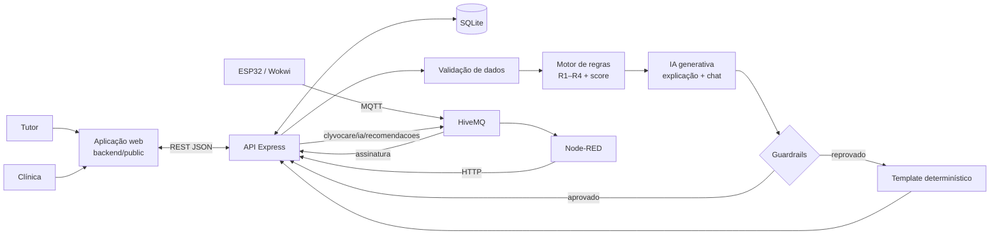

# Sprint 4 — Implementação da IA integrada (ClyvoCare OS)

Este documento mostra **o que foi implementado** a partir da especificação da Sprint 3 e **onde ver a evidência** de cada requisito do enunciado.

## 1. Do que se partiu (Sprint 3) e o que mudou

| Sprint 3 (mantido, sem alteração) | Sprint 4 (novo) |
|---|---|
| Motor de regras como nó Node-RED, com dados simulados | Mesmo motor extraído para módulo (`backend/src/ia/motorRegras.js`), **idêntico** ao nó original (teste diferencial com 600 entradas) |
| Entrada/saída em JSON documentadas | Entrada montada a partir de **banco de dados** (SQLite); saída persistida com auditoria |
| Arquitetura App ↔ API ↔ BD “proposta” | **Implementada**: aplicação web, API REST, SQLite, MQTT, IA |
| LLM como evolução futura | **IA generativa** explicando resultados, com guardrails e fallback |
| Qualidade de dados “esperada” | **Validador** implementado (`validador.js`) |
| Plano de validação com casos esperados | **Testes automatizados** (50) + relatório de resultados |

Arquivos das Sprints 1–3 (`firmware/`, `node-red/clyvocare-nodered-flow.json`, `dashboard/`, `docs/*-IA.md`, `examples/`) permanecem como foram entregues.

## 2. Arquitetura implementada

## 3. Requisitos do enunciado × evidências

| Requisito | Onde está |
|---|---|
| Implementar a IA definida na entrega anterior | `backend/src/ia/motorRegras.js` (R1–R4, score, prioridade, personalização por fase de vida) |
| IA Generativa / agente conversacional | `explicador.js`, `chat.js`, `llmClient.js`, `guardrails.js` — `docs/IA-GENERATIVA.md` |
| Preparar/organizar dados, testes e validação das informações | `backend/src/db/schema.sql`, `seed.js`, `validador.js`, `dados/cenarios-validacao.json`, `tests/validador.test.js` |
| Integração aplicação ↔ BD ↔ APIs ↔ IA | `backend/src/app.js` + `services/` — `docs/API.md`; teste ponta a ponta em `tests/api.test.js` |
| IoT alimentando a IA | `services/iotService.js` (assina MQTT, grava leituras) + `ia/atividade.js` (variação de atividade → R4) |
| Integrada e transparente ao usuário | Interface tutor/clínica mostra origem do texto, fontes de dados, qualidade dos dados, auditoria |
| Funcionalidade acessível ao usuário final | `backend/public/index.html` (tutor: cuidados, chat, IoT, registro; clínica: painel, revisão, métricas) |
| Node-RED integrado | `node-red/clyvocare-nodered-flow-sprint4.json` |
| Testar e validar em cenários reais de uso | `npm test` (52 testes) e `npm run avaliar` → `docs/RELATORIO-RESULTADOS.md` |
| Avaliar resultados e personalização | `docs/RELATORIO-RESULTADOS.md` §2 (mesmo histórico × fases de vida; pets do banco) |
| Evidências (telas, fluxos conversacionais, relatórios) | `docs/evidencias/*.png`, relatório gerado, fluxo de chat nas capturas |
| Vídeo pitch ~5 min | Vídeo no YouTube (não listado): https://youtu.be/Z8Mz_eGe6Iw |

## 4. Decisões de projeto

1. **Híbrido determinístico + generativo.** Decisão clínica (o que priorizar) é auditável e reproduzível; o LLM só comunica. Reduz risco de alucinação em saúde.
2. **Fallback sempre disponível.** Sem internet ou chave, tudo funciona (inclusive para avaliadores).
3. **Humano no circuito.** A clínica aprova/rejeita cada recomendação; o tutor registra adesão. Esses dados viram métricas e base para calibração futura.
4. **IoT com propósito.** O sensor PIR deixa de ser só exibição e passa a gerar o contexto comportamental (R4), com a fonte explicitada.
5. **Rastreabilidade.** Cada execução guarda entrada e saída exatas (`/api/analises/:id`).

## 5. Como reproduzir a demonstração
Ver README (“Como Executar — Sprint 4”). Resumo: `cd backend && npm install && npm start` → abrir `http://localhost:3000` → data de referência **31/08/2026** → Thor exibe 4 recomendações (93, 90, 80, 70).

## 6. Limitações e próximos passos
- Banco: usa o SQLite embutido do Node 22.13+ (`node:sqlite`, experimental no Node) ou `better-sqlite3` como alternativa; a camada `src/db/database.js` expõe a mesma interface para ambos e a suíte de testes passa com os dois drivers.
- Pesos/limiares heurísticos → calibrar com veterinários e dados reais.
- Sem autenticação (protótipo). Em produção: JWT/RBAC, TLS, LGPD.
- Tópicos MQTT do ESP32 não identificam o pet; o protótipo mapeia o dispositivo para um pet (`IOT_PET_ID`). Evolução: incluir `deviceId` no tópico/payload.
- Modelo preditivo e recomendação por aderência dependem de histórico rotulado (feedback já está sendo coletado).
